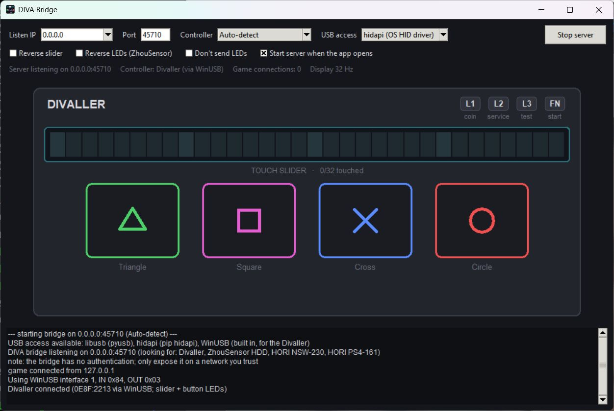

# DIVA Bridge GUI

A window for `diva_bridge.py`: set the listen IP and port, pick the controller,
start/stop the server, and watch the buttons and touch slider live. The HORI
NSW-230 / PS4-161 are drawn like the real controller; the Divaller and
ZhouSensor get a panel view. D-pad and shoulder buttons are shown too.

Keep `diva_bridge_gui.py` and `diva_bridge.py` in the same folder, then run:

    python3 diva_bridge_gui.py        (Windows: py diva_bridge_gui.py)

* **Listen IP** – `127.0.0.1` for the game on the same machine, `0.0.0.0` to
  accept a game on another machine (the bridge has no authentication).
* **Controller** – Auto-detect, or force one. With auto-detect, unplugging one
  controller and plugging in another switches over by itself; no restart needed.
* Settings are remembered (`diva_bridge_gui.json` in your user config folder),
  including "Start server when the app opens".

## Setup per platform

The window only needs Python 3.8+ with Tkinter. For USB access the bridge uses
one or both of:

| Library | Install | Used for |
|---|---|---|
| **hidapi** | `pip install hidapi` (brings its own library) | ZhouSensor, HORI NSW-230, HORI PS4-161 (HID devices) |
| **libusb** | `pip install pyusb` + libusb-1.0 | Divaller (not a HID device); all four on Linux |

"USB access: Auto" picks hidapi for the HID controllers on Windows and macOS and
libusb everywhere else, and falls back to the other one if a library is missing
or opening fails. The status line shows which one is in use.

### Windows
* Python from python.org includes Tkinter.
* `pip install hidapi` – the ZhouSensor and both HORIs then work through the
  normal Windows HID driver: **no Zadig, no driver changes**.
* Divaller: `pip install pyusb`, and either `pip install libusb-package` or put
  `libusb-1.0.dll` (https://github.com/libusb/libusb/releases, `VS2022/MS64/dll`)
  next to `diva_bridge.py`. The Divaller already uses the WinUSB driver.
* With hidapi the controller stays visible to Windows as a normal gamepad, so a
  game reading it directly *and* through the bridge would get input twice. For
  Mega Mix+ with BridgeSlider, set `io_exclusive_controller_input = true` in
  AnySlider's config (or don't run the bridge – Mega Mix+ on Windows supports the
  HORI controllers natively).

### macOS
* Python from python.org includes Tkinter (Homebrew: `brew install python-tk`).
* `pip install hidapi` for the ZhouSensor and the HORIs.
* Divaller: `brew install libusb` and `pip install pyusb`.

### Linux (incl. Steam Deck desktop mode)
* Tkinter: if `python3 -c "import tkinter"` fails, install `python3-tk`
  (Debian/Ubuntu), `python3-tkinter` (Fedora) or `tk` (Arch).
* `pip install pyusb` (libusb-1.0 is normally already installed). Optional:
  `pip install hidapi` as a fallback.
* Install `70-diva-controllers.rules` (included) so it runs without root. On
  Linux libusb takes the controller away from the system gamepad driver while the
  bridge runs, so Steam doesn't see it twice.

## Ready-made program (no Python needed)

Download the zip for your system from the project's Releases / Actions page:

| System | Download | Run |
|---|---|---|
| Windows x64 | `DIVA-Bridge-<ver>-windows-x64.zip` | `DIVA Bridge.exe` |
| Linux x64 (incl. Steam Deck) | `DIVA-Bridge-<ver>-linux-x64.zip` | `./diva-bridge` (install the udev rules) |
| macOS Apple Silicon / Intel | `DIVA-Bridge-<ver>-macos-arm64.zip` / `-macos-x64.zip` | `DIVA Bridge.app` |

The one program is both the window and the bridge. Without a display it also
works as a plain bridge:  `diva-bridge --bridge --tui`  (all the usual
`diva_bridge.py` options apply, e.g. `--port`, `--device`, `--backend`).

macOS: the app isn't signed, so the first time right-click it → **Open**
(or run `xattr -dr com.apple.quarantine "DIVA Bridge.app"`).

## Building it yourself

PyInstaller builds for the system it runs on, so each OS builds its own:

    pip install -r requirements-build.txt
    python build.py                 # → dist/ and dist/DIVA-Bridge-<ver>-<os>-<arch>.zip
    python ci_smoke_test.py         # optional: checks the built program's bridge mode

* Windows → one `DIVA Bridge.exe`; Linux → one `diva-bridge` file;
  macOS → `DIVA Bridge.app` (a folder build, as macOS expects).
* `--onedir` makes a folder build instead (starts faster).
* libusb comes from the `libusb-package` wheel and hidapi from the `hidapi`
  wheel, so nothing else needs installing. Any extra native libraries placed in
  `vendor/` are bundled too.
* Linux: build on the oldest distro you want to support (glibc is forward
  compatible only); the CI uses Ubuntu 22.04.

### All three at once: GitHub Actions

Push this folder to a GitHub repository. `.github/workflows/build.yml` builds
Windows x64, Linux x64, macOS arm64 and macOS x64 on every push, runs the smoke
test on each, and uploads the zips as workflow artifacts. Pushing a tag like
`v1.0.0` also publishes them as a GitHub Release.

    git tag v1.0.0 && git push origin v1.0.0
