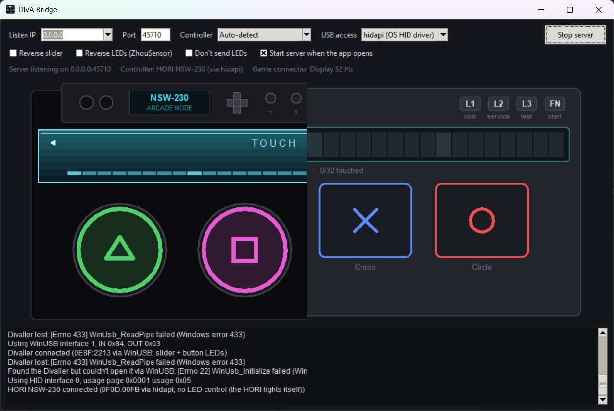

# DIVA Bridge GUI



A cross-platform, networked compatibility layer for Project Diva Future Tone controllers

## Systems Supported

### Windows

* Start up DIVA Bridge.exe

### Linux

* Start up `diva_bridge.py` in CLI or `diva_bridge_gui.py` in desktop environment
* Optional: Set `diva_bridge.py` as a user service (instructions to come)

More in-depth / Steam Deck:

**Starting the server**

(needs SSH access)

1. Copy `diva_bridge.py` to a folder of your choice. We'll use `~/Games/divabridge` as an example.
2. Run `python3 -m venv venv` inside that folder to make a virtual environment.
3. Run `./venv/bin/pip install -r requirements.txt` to add the needed USB libraries
4. Run `./venv/bin/python3 diva_bridge.py` to start the server. Add `--tui` if you want the text GUI to test buttons and the slider
5. Make a startup script, `start.py`, like this: ` echo $(pwd)/venv/bin/python3 $(pwd)diva_bridge.py > start.py` inside the folder you put diva_bridge.py
6. Run start.sh to make sure it works.

**Create a service file:**

```
nano .config/systemd/user/diva_bridge.service
```

Put this in it:
(replace `/home/deck/Games/divabridge` with the location you chose in step 2)
(also **don't forget to make and test that start.sh file**)

```
[Unit]
Description=Divaller Compatibility Service
After=network.target

[Service]
Type=simple
ExecStart=/home/deck/Games/divabridge/start.sh
WorkingDirectory=/home/deck/Games/divabridge/
Restart=always
RestartSec=5

[Install]
WantedBy=default.target
```

Enable and start your new service:

```
systemctl --user enable diva_bridge.service
```

Go to the steps to add the mod or plugin for the game you want to use this for below.

### Mac

* Really?
* Divaller not supported in CFW driver mode

## Controllers Supported

### Hori Hatsune Miku Project DIVA MEGA39's Dedicated Controller (NSW-230)

* Joysticks won't work due to how the slider works

### HORI Hatsune Miku: Project DIVA Future Tone DX Controller (Model PS4-161)

* Joysticks won't work due to how the slider works

### DJ-DAO DIVALLER

* Get the latest firmware (2.4)
* Enable PC Driver Mode (Purple light)

### ZhouSensor Diva Pro-Touch Slider

* UNTESTED
* Enable **Red Mode**

## Games Supported

### [Hatsune Miku: Project DIVA Mega Mix+](https://store.steampowered.com/app/1761390/Hatsune_Miku_Project_DIVA_Mega_Mix/)

* Start **Rhythm Game**
* In the song list, press the button for **Customize**
* Go to **Game/Control Config**
* Go to **Arcade Controller Settings**
* Set **Arcade Controller** to **Enable**

### [PD-Loader](https://github.com/PDModdingCommunity/PD-Loader/releases)

* Set up PD-Loader to use CFW Drivers - https://www.youtube.com/watch?v=PX-kALxfX4s
